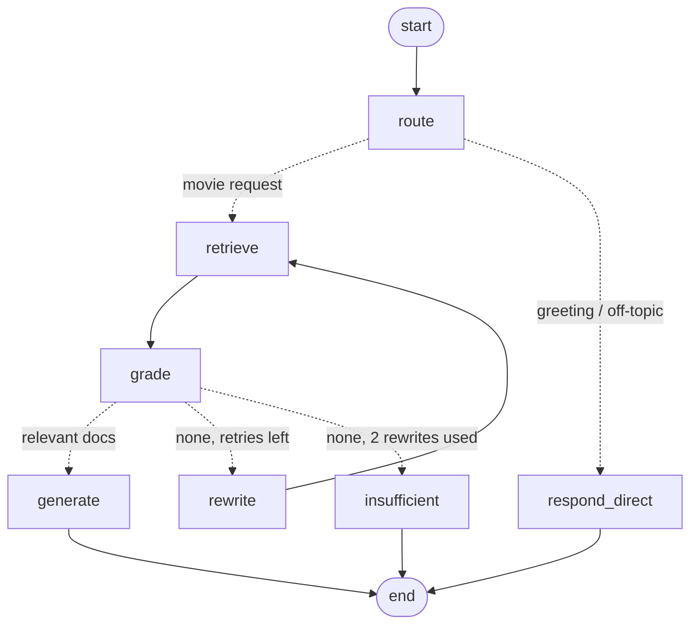

# Agentic RAG Search Engine

Movie discovery over a 5,000-film catalog, built up from keyword search to an
agentic RAG service. Current scope: BM25, dense, hybrid (RRF), cross-encoder
reranking, multimodal image search, and LLM generation via OpenRouter, with a
reproducible retrieval benchmark.

## Status

| Area | Status | Location |
|---|---|---|
| BM25, dense and hybrid (union RRF) retrieval | ✅ Done | `src/retrieval/` |
| Cross-encoder reranking | ✅ Done | `src/retrieval/reranker.py` |
| Retrieval metrics (P/R/MRR/nDCG, latency) + unit tests | ✅ Done | `src/evaluation/`, `tests/` |
| LLM generation, query rewriting, LLM reranking | 🧪 Experimental | `cli/lib/` |
| Multimodal (image → movie) search | 🧪 Experimental | `cli/lib/multimodal_search.py` |
| Qdrant vector store (dense chunks, grouped by movie) | ✅ Done | `src/retrieval/vector_store.py` |
| LangGraph agent (route → retrieve → grade → rewrite → generate) | ✅ Done | `src/agents/` |
| FastAPI service + Next.js UI | ⏳ Phase 4 | |
| RAGAS answer evaluation | ⏳ Phase 5 | |
| Langfuse tracing, Docker Compose, CI | ⏳ Phase 6 | |

## Agent

A LangGraph workflow (a simplified Corrective RAG) that decides whether to
search, checks what it retrieved, rewrites weak queries, and answers only from
cited catalog records.



| Node | What it does |
|---|---|
| `route` | LLM structured output (`retrieve` / `direct`); defaults to retrieve if the output is malformed |
| `retrieve` | Hybrid BM25 + Qdrant dense search with RRF (falls back to in-process dense if Qdrant is down) |
| `grade` | One LLM call grades all retrieved docs; ids the model invents are discarded |
| `rewrite` | Rewrites the search query toward plot terms; at most 2 rewrites |
| `generate` | Answers only from graded docs; citations not in the graded set are dropped, and an answer with no valid citation becomes an explicit "couldn't find" |
| `respond_direct` / `insufficient` | Small talk and off-topic replies; fixed no-result answer |

Guarantees enforced in code and covered by tests: every citation is a
retrieved, graded document; the rewrite loop is bounded (plus a LangGraph
recursion limit as a backstop); unsupported answers say so explicitly.

```bash
uv run python -m src.agents "that one where the guy is stuck alone on mars and grows potatoes"
uv run python -m src.agents --json "family-friendly movie with bears"
uv run python -m src.agents --mermaid   # print the graph
```

Live runs with `anthropic/claude-haiku-5.5` via OpenRouter:

| Question | Path | Result |
|---|---|---|
| family-friendly movie with bears | route → retrieve → grade → generate | 4 cited Care Bears / bear films, ~9 s |
| that one where the guy is stuck alone on mars and grows potatoes | route → retrieve → grade → generate | *The Martian*; notes the catalog text doesn't mention potatoes |
| something where a fish dad crosses the whole ocean to find his kid | route → retrieve → grade → generate | *Finding Nemo* |
| hi, what can you do? | route → respond_direct | capability summary, ~3 s |
| what's the capital of France? | route → respond_direct | polite decline |
| movies about competitive underwater chess tournaments | route → (retrieve → grade → rewrite) ×2 → retrieve → grade → insufficient | explicit "couldn't find", ~16 s |

Hybrid retrieval resolved every vague query on the first attempt, so the
rewrite-then-succeed path is exercised by the mocked tests rather than these
examples. Unit tests (`tests/unit/test_agent.py`) script the LLM and retriever
to cover every path, including malformed model output, without an API key.

## Retrieval benchmark

10-query golden set, k=5. All rows measured in one session, with one untimed
warm-up query; latency is the median per query.

| Configuration | P@5 | R@5 | MRR@5 | nDCG@5 | p50 latency |
|---|---:|---:|---:|---:|---:|
| BM25 | 0.420 | 0.541 | 0.783 | 0.667 | 1,782 ms |
| Dense, in-process (all-MiniLM-L6-v2, 72,909 chunks) | 0.320 | 0.461 | 0.758 | 0.551 | 546 ms |
| **Dense, Qdrant (HNSW, `hnsw_ef=512`)** | 0.320 | 0.461 | 0.758 | 0.551 | **62 ms** |
| Hybrid, in-process dense (union RRF) | 0.440 | 0.567 | 0.808 | 0.678 | 1,765 ms |
| **Hybrid, Qdrant dense (union RRF)** | **0.440** | **0.567** | 0.808 | **0.678** | **1,313 ms** |
| Hybrid Qdrant + cross-encoder (5 candidates) | 0.440 | 0.567 | 0.950 | 0.716 | 1,390 ms |
| Hybrid Qdrant + cross-encoder (20 candidates) | 0.400 | 0.509 | 0.950 | 0.679 | 1,347 ms |

Absolute latencies vary by ±50% between runs on a shared desktop; the ratios
between rows are stable. In a quieter run Qdrant dense measured 15 ms vs 420 ms.

### Phase 2: Qdrant

- **Same quality, ~9-28x faster dense search.** Qdrant stores the same cached
  vectors (one point per chunk) and groups hits by `movie_id` on the server,
  so each movie is scored by its best chunk. Metrics are identical to the
  in-process search, and hybrid results match on all 10 queries.
- **HNSW is approximate, so `hnsw_ef` was tuned.** HNSW is Qdrant's
  approximate nearest-neighbour index, and `hnsw_ef` is how many candidates it
  explores per query. With Qdrant's default, its top-100 movies overlapped
  exact search by only 88% (hybrid uses 100 candidates):

  | Search | Overlap@100 with exact | Search time |
  |---|---:|---:|
  | HNSW, default | 0.884 | 9 ms |
  | HNSW, `hnsw_ef=256` | 0.967 | 11 ms |
  | **HNSW, `hnsw_ef=512`** | **0.991** | **17 ms** |
  | Exact (brute force) | 1.000 | 22 ms |

  At 73k points exact search is still cheap; HNSW matters as the catalog grows.
- **BM25 is now the bottleneck.** It accounts for nearly all of hybrid's
  latency (a pure-Python loop over every document). Moving BM25 into Qdrant as
  sparse vectors is the next optimization.

### Phase 1: hybrid fixes

Union RRF improved nDCG@5 from 0.670 to 0.678 and cut hybrid latency from
~3.9 s to ~1.7 s. What changed from the original hybrid search:

- **Union instead of intersection.** The original scored only documents found
  by *both* retrievers. RRF now scores the union, so keyword-only or
  semantic-only matches survive.
- **Rank maps instead of list scans.** Fusion was O(docs × list length); it is
  now a single pass (`src/retrieval/fusion.py`).
- **Index loaded once**, not unpickled on every query.
- **No rounding before sorting.** Sorting on `round(score, 3)` created ties that
  were broken by movie id instead of relevance.

Caveats: 10 queries is too few for ~0.01 nDCG differences to be significant.
Reranking 20 candidates scores lower than 5 largely because the cross-encoder
surfaces good but unlabeled titles (e.g. *Resident Evil: Apocalypse* for
"zombie apocalypse"), so the golden set needs expanding before choosing a
reranker configuration.

Reproduce:

```bash
uv run python -m src.retrieval.evaluate --retriever hybrid_qdrant --k 5
uv run python -m src.retrieval.evaluate --retriever hybrid_qdrant \
  --reranker cross_encoder --k 5 --candidates 20
```

`--retriever` accepts `bm25`, `dense`, `qdrant`, `hybrid` or `hybrid_qdrant`.
The Qdrant options need the setup below.

## Setup

Requires Python 3.13+ and [uv](https://docs.astral.sh/uv/).

```bash
uv sync
uv run pytest
```

**Data.** `data/` and `cache/` are gitignored. Place these files locally:

- `data/movies.json`: the movie catalog
- `data/stopwords.txt`
- `data/golden_dataset.json`: relevance judgments for evaluation

Indexes and embeddings are built into `cache/` on first run, and models are
downloaded on first use. Setting `HF_TOKEN` avoids Hugging Face rate limits.

**Qdrant.** Start the server, then load the cached chunk embeddings into it
(about 30 s, no re-embedding):

```bash
docker compose up -d                        # Qdrant 1.20 on :6333, data in the qdrant_data volume
uv run python -m src.retrieval.ingest       # add --recreate to rebuild
curl -s localhost:6333/collections/movie_chunks   # expect points_count 72909
```

The dashboard is at http://localhost:6333/dashboard. Set `QDRANT_URL` to use
a different server. Unit tests use Qdrant's in-memory mode and need no server.

**LLM features.** Generation, query rewriting and LLM reranking need an
OpenRouter key in `.env` (never committed):

```env
OPENROUTER_API_KEY=your_key_here
AGENT_MODEL=anthropic/claude-haiku-5.5   # optional; any OpenRouter model with structured outputs
```

Retrieval, evaluation and tests run without a key.

## CLI

The original command-line tools in `cli/` still work:

```bash
# Keyword / semantic
uv run python cli/keyword_search_cli.py build
uv run python cli/keyword_search_cli.py bm25search "space adventure" --limit 5
uv run python cli/semantic_search_cli.py search_chunked "revenge drama" --limit 5

# Hybrid, with optional LLM query rewrite and reranking
uv run python cli/hybrid_search_cli.py rrf-search "heist thriller" --limit 5
uv run python cli/hybrid_search_cli.py rrf-search "scary bear movie" \
  --enhance rewrite --rerank-method cross_encoder --limit 5

# RAG generation (needs OPENROUTER_API_KEY)
uv run python cli/augmented_generation_cli.py rag "best dystopian movies"
uv run python cli/augmented_generation_cli.py citations "movies about survival" --limit 5

# Multimodal
uv run python cli/multimodal_search_cli.py image_search data/paddington.jpeg
```

Each script supports `--help`.

## Layout

```text
src/
  agents/        # LangGraph state, nodes, prompts, graph and CLI
  retrieval/     # Retriever protocol; BM25, dense, Qdrant, hybrid, fusion,
                 # reranker, ingest and evaluator
  evaluation/    # Ranking metrics
tests/unit/      # Agent, fusion, metrics, vector store and LLM-client tests
cli/             # Original CLI tools; cli/lib holds the underlying implementations
docker-compose.yml
```

`src/` is the application layer that new features go into. Its BM25 and dense
adapters wrap the implementations in `cli/lib`, which will be migrated over
one capability at a time.

## Roadmap

1. **Phase 1 (finish):** validated dataset loading; commit the golden set so
   CI can evaluate; grow it to ~30 queries.
2. **Phase 2, Qdrant:** ✅ dense retrieval in Qdrant, benchmarked above.
   Follow-up: BM25 as Qdrant sparse vectors (a movie-level collection with
   the IDF modifier), so that server-side prefetch + RRF fusion can be
   compared against the Python RRF and the BM25 bottleneck goes away.
3. **Phase 3, agent:** ✅ LangGraph workflow with bounded rewrites,
   validated citations and an explicit no-result answer (see Agent above).
4. **Phase 4, API and UI:** FastAPI `/chat` returning the answer, sources and
   the graph path taken, plus a Next.js chat UI.
5. **Phase 5, evaluation:** RAGAS faithfulness, answer relevancy, and
   context precision/recall, comparing plain RAG with the agent.
6. **Phase 6, ops:** Langfuse tracing, Docker Compose, and GitHub Actions
   running tests with mocked LLM calls.

## License

GPL-3.0. See [LICENSE](LICENSE).
